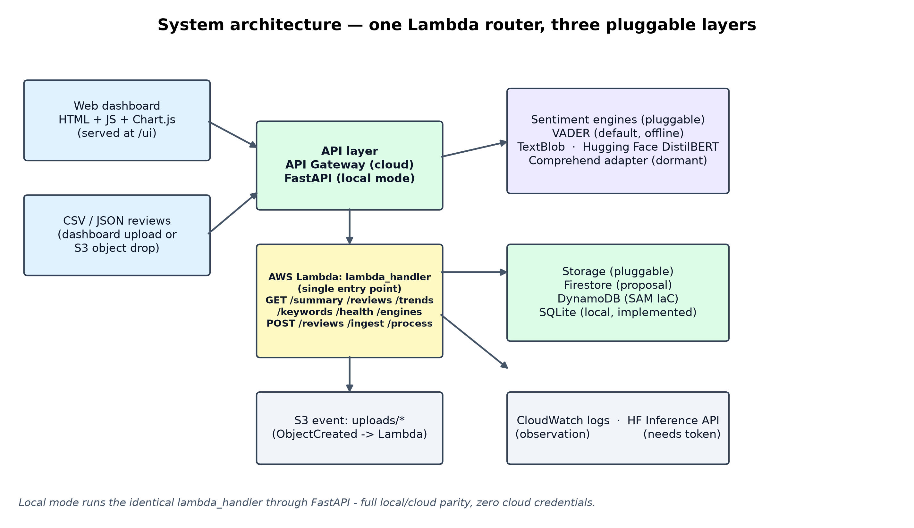
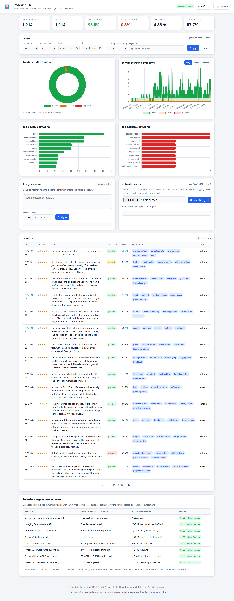
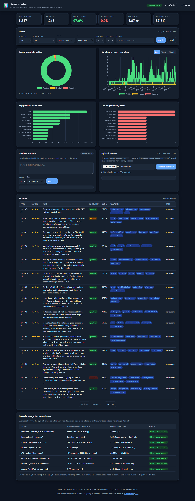
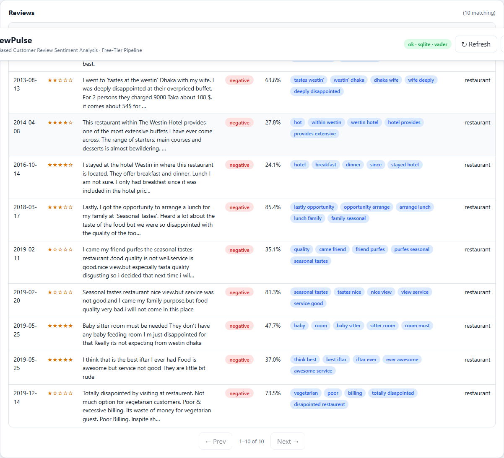
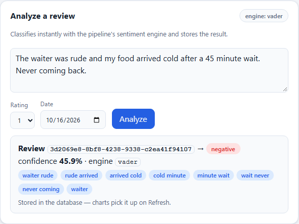

# Cloud-Based Customer Review Sentiment Analysis Dashboard

**A serverless, free-tier cloud pipeline for small-business review analytics** — ingest customer reviews, classify sentiment with a pluggable engine, store the results, and publish an interactive dashboard, all with **zero always-on servers**.

Small businesses sit on hundreds of customer reviews but cannot afford SaaS analytics (~$299/month). This project shows the whole loop — ingestion → sentiment processing → storage → live dashboard — running inside free-tier limits, on real public data (1,214 cleaned TripAdvisor restaurant reviews), with every published number produced by an executed, seeded experiment run. Local mode runs the exact same Lambda handler code as cloud mode, so the entire system works offline with no credentials.

| | |
|---|---|
| Author | **Ahmed Bin Jaffar** — MSDS Semester 2, MUET |
| Course | Cloud Computing |
| License | MIT |



## Highlights

- **Sentiment engine, pluggable:** VADER (default, offline), TextBlob, Hugging Face DistilBERT (local or Inference API), Amazon Comprehend (adapter) — switched by one environment variable
- **Local = cloud parity:** one `lambda_handler` router serves API Gateway v1/v2 and S3 events; a FastAPI server calls the same handlers locally, so everything is testable without AWS
- **Interactive dashboard** (vanilla HTML/CSS/JS + Chart.js): sentiment distribution, review trend over time, top keywords, filterable review table, live analyze and CSV upload
- **Cost model with sourced prices:** every price tagged with a source URL and access date
- **105 pytest tests + 9/9 browser end-to-end checks**, fully offline, seed 42

## Results (all measured, seed 42, CPU-only)

| Metric | Value |
|---|---|
| VADER accuracy on 1,214 real reviews | **0.9712** (macro-F1 0.4757 on a 98%-positive skew) |
| Inference latency | **0.219 ms**/review (VADER) — ~228× faster than DistilBERT (49.8 ms) |
| Warm API latency | **0.476 ms** mean (p95 0.854 ms) |
| Cold start (local proxy) | **3.42 s** VADER vs **22.8 s** DistilBERT (18.6 s of it model load) |
| Ingestion throughput | **17,416** reviews/s (1,000-row batch), <150 MB RSS |
| Monthly cost @ 1M reviews | **$2.50** free tier · $3.35 pay-as-you-go · vs **$8.23** EC2 t3.micro and **$300.49** Comprehend |
| Test suite | **105 passed** · browser E2E **9/9** |

Method, caveats and every intermediate number: [`experiments/RESULTS_SUMMARY.md`](experiments/RESULTS_SUMMARY.md).

## Screenshots

| | |
|---|---|
|  |  |
|  |  |

More: upload flow (`05_upload_result.png`), mobile dark (`06_mobile_dark.png`) in [`docs/screenshots/`](docs/screenshots/).

## Tech stack

| Layer | Choice |
|---|---|
| Language / runtime | Python 3.10+ (developed on 3.13, Windows 11, CPU-only) |
| NLP | VADER · TextBlob · Hugging Face DistilBERT-SST2 · Comprehend adapter |
| API | FastAPI + Uvicorn (local) · AWS Lambda + API Gateway (cloud) |
| Storage | SQLite (local) · DynamoDB (written, opt-in) · Firestore adapter |
| IaC | AWS SAM (`infrastructure/template.yaml`) |
| Dashboard | Vanilla HTML/CSS/JS + Chart.js (vendored, no build step) |
| Testing | pytest · Playwright browser E2E · ruff |
| Media/docs | python-docx / python-pptx generators, ffmpeg (video, local only) |

## Quick start (Windows, local mode, no credentials)

```powershell
git clone https://github.com/ahmedbinjaffar/cloud-review-sentiment-dashboard.git
cd cloud-review-sentiment-dashboard
.\scripts\run_local.ps1
```

That one script creates `.venv`, installs `requirements.txt`, copies `.env.example` → `.env`, seeds SQLite from the committed 20-row sample, and starts the server. Then open:

| What | URL |
|---|---|
| **Dashboard** | <http://127.0.0.1:8000/ui/> |
| API docs (Swagger) | <http://127.0.0.1:8000/docs> |
| Health / summary | <http://127.0.0.1:8000/health> · `/summary` |

Stop with `Ctrl+C`. Step-by-step (manual venv, seeding, re-seeding) is in the collapsed block below.

<details>
<summary>Manual install</summary>

```powershell
python -m venv .venv
.\.venv\Scripts\Activate.ps1
pip install -r requirements.txt
Copy-Item .env.example .env     # add HF_TOKEN etc. only if you have one

python scripts\seed_db.py --reset --process
.\scripts\run_local.ps1
```

If scripts are blocked on a fresh machine:
`Set-ExecutionPolicy -Scope Process -ExecutionPolicy Bypass`
</details>

### The dataset

The repo ships `data/sample_reviews.csv` (20 real, rating-stratified rows). The
**full 1,214-row dataset is not committed** (licence-friendly but kept out of the
repo by policy). `seed_db.py` uses it automatically when present; to rebuild it:

1. Download `tripadvisor_reviews_updated.csv` (MIT) from the source listed in [`data/DATASET_SOURCE.md`](data/DATASET_SOURCE.md) into `data/raw/`
2. `python scripts\prepare_dataset.py` — cleans, dedupes and writes `data/reviews.csv`
3. `python scripts\seed_db.py --reset --process`

## Tests

```powershell
.\.venv\Scripts\python.exe -m pytest        # → 105 passed (~20 s, offline, no credentials)
.\.venv\Scripts\python.exe -m ruff check .  # → All checks passed
```

Browser end-to-end (start the server first, second terminal):

```powershell
.\.venv\Scripts\python.exe scripts\e2e_dashboard.py   # → 9/9 checks passed
```

Recorded test log: [`docs/TEST_REPORT.md`](docs/TEST_REPORT.md).

## Re-running the experiments

```powershell
.\scripts\run_experiments.ps1
```

Runs the five seeded experiments (model comparison, ablation, latency, throughput, cost model) and writes raw measurements to `results/` (git-ignored) plus 300-dpi charts to `figures/`. Summary with all tables: [`experiments/RESULTS_SUMMARY.md`](experiments/RESULTS_SUMMARY.md). The Hugging Face runs dominate wall time (CPU model load + 1,214 inferences); everything else is offline.

## Cloud deployment (summary)

The design target is the proposal's free-tier stack (Firebase Firestore, Hugging Face, Streamlit Community Cloud). An **AWS SAM** alternative is included and is strictly opt-in — it has never been deployed (no AWS credentials in the dev environment):

```powershell
.\scripts\deploy.ps1     # sam build + deploy + dashboard sync (needs AWS creds)
.\scripts\teardown.ps1   # empty buckets + sam delete
```

Full walkthrough, IAM notes and cost caveats: [`docs/DEPLOYMENT_GUIDE.md`](docs/DEPLOYMENT_GUIDE.md).

## Free-tier cost notes

Monthly cost of ingest + classify + store + dashboard (measured pipeline inputs, sourced AWS prices):

| Reviews/month | AWS free tier | AWS pay-as-you-go | EC2 t3.micro | Comprehend API |
|---:|---:|---:|---:|---:|
| 1,000 | **$0.0025** | $0.0034 | $8.23 | $0.30 |
| 1,000,000 | **$2.50** | $3.3513 | $8.23 | $300.49 |

Honest caveat baked into the model: DynamoDB **on-demand** tables bill per request even "inside" the free tier, so 1M reviews is $2.50/month, not $0. Full table, formulas and per-price source URLs: [`experiments/RESULTS_SUMMARY.md`](experiments/RESULTS_SUMMARY.md) § d.

## Project structure

```
├── src/               pipeline package: config, models, cleaning, analytics,
│                      4 sentiment engines, storage adapters, Lambda handlers,
│                      FastAPI local server
├── scripts/           runnable entry points: run_local, seed_db, prepare_dataset,
│                      e2e_dashboard, run_experiments, deploy/teardown, generators
├── dashboard/         web UI (HTML/CSS/JS + vendored Chart.js), served at /ui/
├── infrastructure/    AWS SAM template + Lambda requirements (opt-in)
├── tests/             pytest suite (105 tests, offline)
├── experiments/       five experiment runners + RESULTS_SUMMARY.md
├── data/              sample_reviews.csv (20 rows) + DATASET_SOURCE.md
├── docs/              project report, test report, deployment guide, screenshots
└── presentation/      Project_Presentation.pptx
```

## Not included in this repository (by design)

- **Full dataset** (`data/reviews.csv`, `data/raw/`) — rebuild instructions above
- **Raw experiment outputs** (`results/`, `figures/`) — regenerate with `run_experiments.ps1`
- **Demo video** (7.4 min, with voice-over) — available on request
- **Credentials** of any kind — `.env` is git-ignored; only `.env.example` ships

## Author

**Ahmed Bin Jaffar** · MSDS Semester 2 · Mehran University of Engineering and Technology (MUET), Jamshoro · [GitHub](https://github.com/ahmedbinjaffar)

Feedback and suggestions are very welcome — open an issue or a PR.

## License

[MIT](LICENSE)
